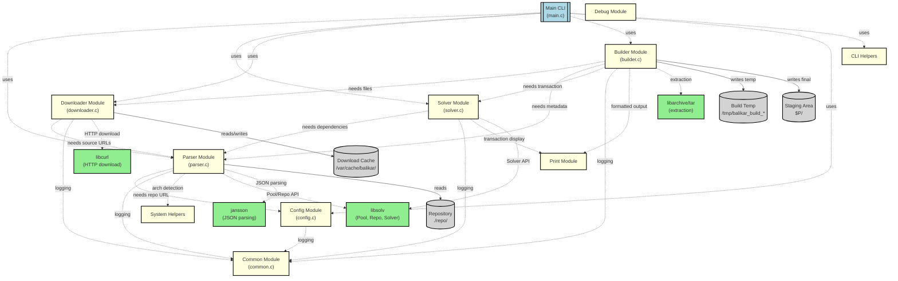

# Balikar Component Diagram (Mermaid)



## Vysvětlení komponent

### Hlavní komponenty

1. **Main CLI (main.c)** - Entry point, command dispatcher
   - Zpracovává příkazy: `build`, `install`, `resolve`, `repos`, `download`, `clean-cache`

2. **Parser Module** - Repository parsing, metadata loading
   - `load_repository()` - načte repodata.json
   - `get_custom_source()` - získá source URLs
   - `get_custom_mkdeps()` - získá makedeps
   - `parse_depends()` - parsuje závislosti

3. **Solver Module** - Dependency resolution
   - `solve_dependencies()` - resolvne závislosti
   - `create_solver()` - vytvoří solver
   - `add_mkdeps_to_queue()` - přidá makedeps rekurzivně

4. **Downloader Module** - Package downloading, cache management
   - `download_package()` - stáhne balíček
   - `download_extras()` - stáhne patches
   - Multi-source fallback (zkouší všechny URL v pořadí)

5. **Builder Module** - Build automation
   - `commit_element()` - hlavní build funkce
   - `extract_archive()` - extrakce tar archivů
   - `apply_extras()` - aplikace patches
   - `find_source_path()` - rekurzivní hledání .build

6. **Config Module** - Repository configuration
   - Načítá `repos.conf` (user > system > default)
   - Spravuje priority repozitářů

7. **Common Module** - Logging, error handling
   - `log_info()`, `log_warn()`, `log_error()`
   - Error codes (ERR_NO_REPO, ERR_SOLVE_FAIL, ...)

### Utility moduly

- **CLI Helpers** - User prompts, help text
- **System Helpers** - Architecture detection (x86_64, noarch)
- **Print Module** - Formatted output (transaction display)
- **Debug Module** - Debug logging (DEBUG 1/2)

### Externí knihovny

- **libsolv** - Dependency resolution engine (z openSUSE)
- **jansson** - JSON parsing
- **libcurl** - HTTP/HTTPS downloads
- **libarchive/tar** - Archive extraction

### Datová úložiště

- **Repository** (`./repo/`) - Balíčky a metadata
- **Download Cache** (`/var/cache/balikar/`) - Stažené soubory
- **Staging Area** (`$P/`) - Built packages před instalací
- **Build Temp** (`/tmp/balikar_build_*`) - Dočasné build dirs

## Workflow

```
User Command → Main CLI
              ↓
         Config (load repos.conf)
              ↓
         Parser (load repodata.json)
              ↓
         Solver (resolve dependencies + makedeps)
              ↓
         User Confirmation
              ↓
         Downloader (download packages + extras)
              ↓
         Builder (extract → patch → build)
              ↓
         Staging ($P/) → Ready for install
```

## Rendering

Pro vykreslení PlantUML diagramu:
```bash
plantuml doc/diagrams/component_diagram.puml
# Vytvoří component_diagram.png
```

Pro náhled Mermaid diagramu:
- GitHub automaticky renderuje Mermaid v Markdown
- VS Code: nainstaluj "Markdown Preview Mermaid Support"
- Online: https://mermaid.live/
